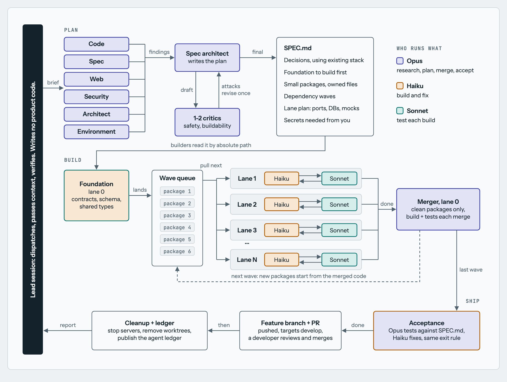

# Blackbird Software Factory

A Claude Code skill that turns one task into a tested feature branch and a pull request, using teams of agents. It spends tokens to save calendar time: good research up front lets cheap agents build reliably.

Built at [Blackbird](https://blackbird-lab.com) and shared for anyone who wants to use it.



For the full walkthrough, including the build and test loop and per-lane resources, download [`software-factory-map.html`](software-factory-map.html) and open it in a browser.

## Install

Run these two commands inside Claude Code:

```text
/plugin marketplace add ydrozd-blackbird/software-factory
/plugin install blackbird@blackbird-lab
```

To open pull requests, the factory also needs `gh` or `glab` signed in.

## Use

Don't give the factory a three-word task. It runs on its own once it starts, so the output depends on the context you put in at the beginning.

**The author's recommendation is to talk, not type.** Open the main agent in the repo you want to change, start a voice dictation tool such as Whisper, and say everything you can think of: what you want and why, who it's for, how you picture it working, what worries you, what you've already tried, and what's out of scope. Don't tidy it up. Rambling is fine, because the research team sorts it out. The factory saves your words unchanged in `.factory/BRIEF.md`, a local file that isn't committed, and checks the plan and the final result against them. Your brief can still reach the agents and your model provider, so don't dictate secrets.

A short request gives the agents very little to work from:

```text
/blackbird:software-factory Add multi-location scheduling
```

A dictated brief gives them your actual thinking:

```text
/blackbird:software-factory So we need multi-location scheduling. Right now every
shift belongs to one location, and that breaks for our bigger customers because their
staff move between sites during the week. Managers keep double-booking people
and only find out when someone doesn't show up, so catching that conflict is
the main thing I care about. Each location has its own time zone, and I've been
burned by time zone bugs in this code before, so please look hard at that. I
picture a location switcher at the top of the schedule page, kind of like the
one we already have in reports, so reuse that if you can. Existing customers
have to keep working without doing anything, so everything they have today
should move to a default location. Don't touch payroll or billing in this one.
I don't know yet if managers should only see their own locations. Look at what
the permissions code does today and tell me what you'd recommend.
```

Running the skill allows the factory to push its branch and open a pull request. It never merges; a developer reviews and merges.

## How it works

| Stage | Who | What happens |
|---|---|---|
| Research | Opus | Agents cover code, spec, web, security, architecture, and machine capacity. An architect and critics turn the findings into `SPEC.md`. |
| Build and test | Haiku + Sonnet | Pairs work in separate git worktrees, usually each with its own port and database. Haiku fixes critical and high bugs until none remain or the cycle limit is reached. Medium and low bugs are logged. |
| Merge and accept | Opus + Haiku | A merger integrates each wave. Opus then tests against the spec and Haiku fixes what it finds. |
| Ship | Lead session | The work goes up as `feature/`, `bugfix/`, or `hotfix/` with a pull request, following Git Flow. The factory then removes its worktrees and publishes an agent ledger. |

The session you talk to is the lead. It dispatches agents, passes context between teams, and verifies results, but writes no product code.

## What you get

- **A pull request** whose description stands alone: what changed, how it was tested, and any open bugs. It's a draft if anything couldn't be verified.
- **An agent ledger**, published as a private Claude artifact where that's available and saved to `.factory/LEDGER.html` either way. It shows every agent's model, timing, tokens, and tool calls from Claude Code's own records, along with each package's outcome. It never includes prompts or agent output.

## Before you run it

- **Cost:** a large run can use hundreds of agents. Use it when speed matters more than token cost. It isn't tuned for small changes yet.
- **Permissions:** to run unattended, pre-approve the commands it needs, such as `git`, `docker`, your database tools, and `gh` or `glab`. Otherwise the first permission prompt pauses the run until you answer.
- **Machine:** the factory measures RAM, CPU, and disk to choose how many lanes to run, and it mocks what it can to fit more.
- **Status:** this is an early release with little real-world use. The worktree script, git steps, and agent loop have been checked in a throwaway repo with stubbed agents.

## Layout

```text
skills/software-factory/SKILL.md   The skill
skills/software-factory/scripts/   Agent ledger generator
.claude-plugin/                    Claude Code plugin files
software-factory-map.html          Full visual walkthrough
docs/factory-line.png              Diagram used in this README
```

## License

[MIT](LICENSE)
